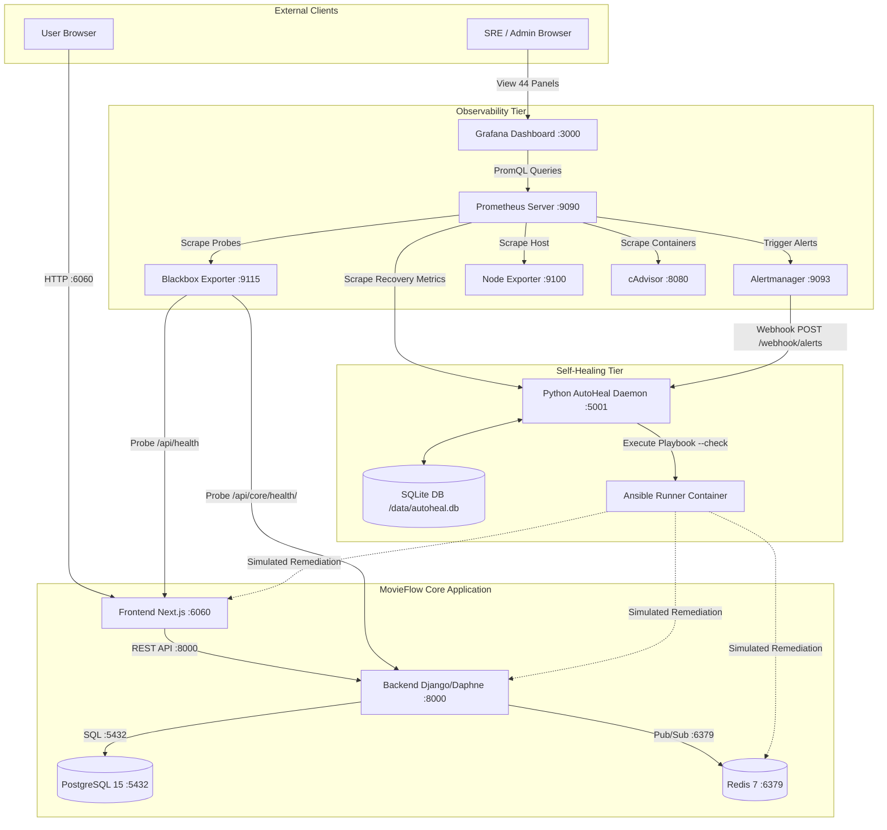
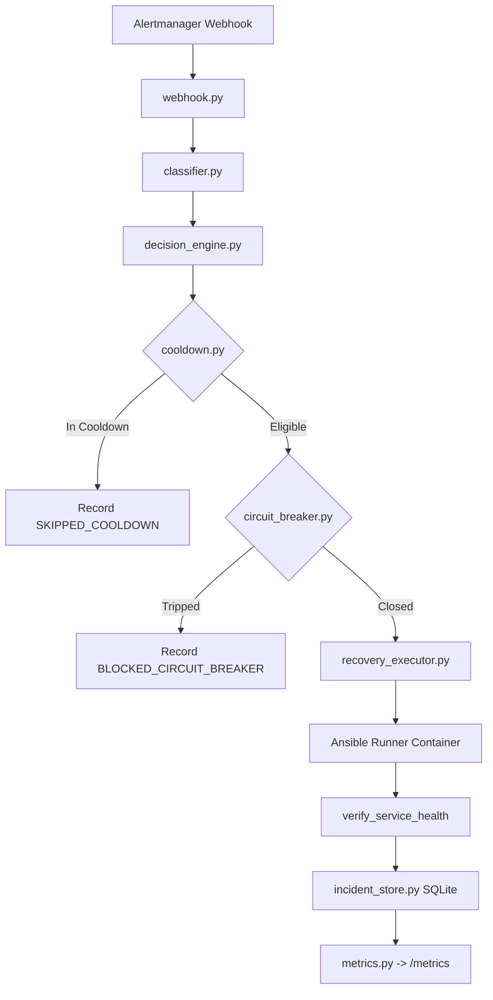
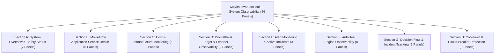

# ACADEMIC PROJECT REPORT

# MovieFlow AutoHeal: Intelligent Infrastructure Monitoring, Automated Deployment, and Self-Healing Platform for Distributed Web Applications

**Course Code:** INT333  
**Course Title:** Cloud Infrastructure & Automation Engineering  
**Academic Year:** 2026–2027  

**Student Name:** [Student Name Placeholder]  
**Registration Number:** [Registration Number Placeholder]  
**Department:** Department of Computer Science & Engineering  
**Institution:** [Institution Name Placeholder]  
**Date of Submission:** November 2026  

---

## Abstract

As cloud architectures transition to distributed containerized microservices, system availability and fault recovery have become paramount challenges. Conventional operations depend heavily on human monitoring, diagnostic triage, and manual remediation, introducing latency and operational inconsistency during critical service outages. 

This project presents **MovieFlow AutoHeal**, an end-to-end infrastructure monitoring, automated deployment, and safety-bounded self-healing platform developed for the **MovieFlow** social streaming application. The platform orchestrates multi-container workloads across Next.js, Django/Daphne ASGI, PostgreSQL, and Redis. It establishes continuous observability through Prometheus, Alertmanager, Blackbox Exporter, Node Exporter, and cAdvisor. A dedicated Python/FastAPI AutoHeal engine ingests alert webhooks, deterministically classifies incidents with confidence scoring, enforces concentric safety boundaries (service allowlisting, permanent database shielding, 300-second anti-flap cooldowns, and consecutive-failure circuit breakers), and coordinates idempotent remediation via containerized Ansible playbooks. Operating in strictly verified dry-run simulation mode (`DRY_RUN=True`), the system provides comprehensive telemetry through an enhanced 44-panel Grafana dashboard. In an isolated evaluation across 43 automated test assertions, the decision engine demonstrated sub-millisecond classification and decision latencies (0.12 ms average) and an end-to-end pipeline latency of 19.21 ms without incurring any live system disruption or downtime.

**Keywords:** Infrastructure Monitoring, Self-Healing Systems, Site Reliability Engineering, Prometheus, Ansible Automation, FastAPI, Grafana, Docker.

---

## Acknowledgements
*[Acknowledgement Placeholder]*  
*I express my sincere gratitude to the faculty advisor, course instructors, and laboratory staff of the Department of Computer Science and Engineering for their continuous guidance, technical support, and critical evaluation throughout the development of the MovieFlow AutoHeal project.*

---

## Table of Contents
*[Table of Contents Placeholder]*
1. Introduction
2. Problem Statement & Motivation
3. Project Objectives & Scope
4. Literature Review & Background Overview
5. Proposed Architecture & System Design
6. Requirements Analysis
7. System Implementation
8. Safety Guardrails & Policy Enforcement
9. Observability & Dashboard Visualization
10. Testing Methodology & Verification Results
11. Performance Evaluation & Discussion
12. Security Analysis & Threat Modeling
13. Limitations & Future Enhancements
14. Conclusion & References

---

## 1. Introduction

High availability in web-scale distributed applications requires continuous real-time insight into compute resources, network throughput, and application process health. Modern web platforms are composed of heterogeneous tiers: client-side rendered frontends, asynchronous API gateways, relational databases, and low-latency cache brokers. Each layer possesses unique failure modes—from WebSocket connection exhaustion to memory saturation.

Automated incident response platforms, often termed self-healing systems, continuously monitor infrastructure metrics, detect deviations from healthy baseline thresholds, evaluate remediation logic, and execute corrective measures autonomously. By minimizing human intervention, self-healing platforms aim to lower Mean Time to Recovery (MTTR) from tens of minutes to seconds. 

The **MovieFlow AutoHeal** project demonstrates the practical engineering, implementation, and academic evaluation of a closed-loop self-healing architecture tailored to an active social streaming application.

---

## 2. Problem Statement

Modern containerized web services face frequent transient and systemic faults:
1. **Application Process Freezes:** Background workers and ASGI processes can hang without triggering host-level container termination.
2. **Notification Fatigue & Delayed Response:** Human operators often take 10 to 30 minutes to detect, triage, and restart failing services during off-peak hours.
3. **Danger of Runaway Automation:** Naive auto-restart configurations (such as unconstrained Docker restart policies) risk infinite crash loops and catastrophic corruption if applied indiscriminately to stateful relational databases like PostgreSQL.
4. **Lack of Remediation Observability:** Conventional shell scripts execute out-of-band without structured logging, telemetry exposure, or operator dashboards.

The objective is to construct a system that detects failures accurately via synthetic external probing, evaluates remediation safety deterministically, enforces strict circuit-breaking and anti-oscillation constraints, executes idempotent recovery, and exposes all operational states visually.

---

## 3. Motivation

Manual infrastructure management is inherently unscalable and vulnerable to human fatigue. Industry studies indicate that over 70% of cloud downtime costs stem from diagnostic and coordination delays rather than the physical time required to restart a service. Creating an intelligent, bounded self-healing platform provides substantial academic and operational value:
- It models the core tenets of Google Site Reliability Engineering (SRE): eliminating toil, automating repetitive remediation, and establishing defensive safety invariants.
- It showcases the integration of modern cloud-native standards (Prometheus metric formats, Alertmanager routing, Ansible configuration automation, and FastAPI asynchronous programming).
- It provides a safe, educational testbed for studying closed-loop control systems within software engineering.

---

## 4. Objectives

The primary engineering objectives of this project are:
1. **Containerized Deployment:** Encapsulate the entire MovieFlow platform (Next.js, Django/Daphne, PostgreSQL, Redis) into isolated Docker Compose network topologies.
2. **Comprehensive Observability:** Deploy Prometheus, Alertmanager, Grafana, Node Exporter, cAdvisor, and Blackbox Exporter to monitor system, container, and application metrics.
3. **Proactive Alerting:** Formulate alert rules for service unavailability, container restarts, and host resource saturation.
4. **Intelligent Decision Engine:** Implement a Python/FastAPI microservice to parse alert webhooks, classify failure patterns, compute confidence levels, and map deterministic remediation actions.
5. **Ansible Recovery Automation:** Author modular, idempotent playbooks to automate container recovery safely.
6. **Concentric Safety Architecture:** Enforce strict service allowlists, explicit forbidden target blocks (protecting PostgreSQL and monitoring tiers), 300s cooldown timers, and 3-strike circuit breakers.
7. **Single-Pane Observability:** Build an enhanced 44-panel Grafana dashboard with real-time health indicators and visual dry-run safety banners.
8. **Empirical Verification:** Conduct an isolated 43-assertion testing suite to validate classification, decision safety, and latency performance.

---

## 5. Scope

### Included in Scope
- Orchestration and deployment of the 4-tier MovieFlow application on Docker Compose.
- Deployment of 6 dedicated monitoring and observability services.
- Implementation of the AutoHeal engine daemon with RESTful endpoints (`/health`, `/status`, `/incidents`, `/recovery/status`, `/metrics`).
- Implementation of containerized Ansible playbooks for Frontend, Backend, and Redis.
- Implementation of safety guardrails and dry-run simulation mode (`DRY_RUN=True`).
- Design and deployment of the 44-panel Grafana dashboard.
- Safe simulation-based unit, integration, and security testing.

### Explicitly Excluded from Scope
- Automated recovery of PostgreSQL or relational storage (strictly monitoring-only).
- Automated recovery of monitoring services (Prometheus, Grafana, Alertmanager).
- Physical fault injection causing live container destruction or data loss.
- Multi-cloud public hosting (project validated locally on Windows 11 / Docker Desktop).

---

## 6. Literature & Background Overview

### 6.1 Evolution of Self-Healing Systems
Self-healing software architectures trace their foundations to IBM's 2001 Autonomic Computing initiative, which formalized the **MAPE-K loop**:
- **Monitor:** Continuous telemetry collection across host and application layers.
- **Analyze:** Metric evaluation, anomaly detection, and threshold comparison.
- **Plan:** Selecting optimal remediation workflows based on policy and state.
- **Execute:** Dispatching automation agents to restore service health.
- **Knowledge:** Maintaining historical records of incidents, cooldowns, and outcomes.

MovieFlow AutoHeal implements a concrete realization of the MAPE-K loop: Prometheus acts as the *Monitor*, Alertmanager as the *Analyzer*, the AutoHeal Python Engine as the *Planner*, Ansible as the *Executor*, and SQLite as the *Knowledge* repository.

### 6.2 Comparison of Automation Paradigms
| Approach | Strengths | Weaknesses | Suitability for MovieFlow |
| :--- | :--- | :--- | :---: |
| **Shell Scripts (Cron)** | Simple, lightweight | Imperative, non-idempotent, lacks structured error handling | Unsuitable |
| **Docker Restart Policies** | Automatic container restarts | Blind loops; restarts crashed database; no cooldown or triage | Unsuitable |
| **Ansible Automation** | Declarative, idempotent, auditable, check-mode simulation | Requires execution runner environment | **Selected** |

---

## 7. Proposed System Architecture

The MovieFlow AutoHeal architecture integrates three decoupled subsystems:
1. **The Application Tier:** User-facing streaming and coordination services.
2. **The Observability Tier:** Metric scrapers, synthetic blackbox probes, and visualization panels.
3. **The Self-Healing Controller:** Alert ingestion, decision intelligence, safety gates, and Ansible automation.



---

## 8. Existing vs. Proposed System

| Dimension | Existing / Traditional System | Proposed MovieFlow AutoHeal Platform |
| :--- | :--- | :--- |
| **Detection Method** | Passive user bug reports or raw unformatted logs | Proactive synthetic HTTP probing every 15s via Blackbox Exporter |
| **Notification Flow** | Asynchronous email/SMS alerts to on-call personnel | Automated webhook delivery directly into the AutoHeal decision engine |
| **Response Latency** | 10 to 30 minutes average manual triage lag | Sub-second decision making (0.12 ms average decision latency) |
| **Remediation Execution** | Manual CLI `docker restart` commands by operators | Idempotent Ansible playbooks with syntax checking and health checks |
| **Database Protection** | Dependent on human diligence; high risk of DB reboot | Hard-coded architectural prohibition (`SKIPPED_FORBIDDEN_SERVICE`) |
| **Flapping Prevention** | None; risk of infinite restart loops on persistent bugs | 300-second per-service cooldown + 3-strike circuit breaker |
| **System Visibility** | Fragmented terminal logs and disparate monitoring pages | Single-pane 44-panel Grafana dashboard with live recovery metrics |

---

## 9. Requirements Analysis

### 9.1 Functional Requirements
- **FR1:** Continuous synthetic probing of frontend (`/api/health`) and backend (`/api/core/health/`) endpoints every 15 seconds.
- **FR2:** Automated evaluation of alerting rules for service availability, scrape target health, and resource thresholds.
- **FR3:** Ingestion and validation of Alertmanager JSON alert webhooks via a REST API endpoint.
- **FR4:** Automated alert classification mapping alert signatures to normalized service entities with confidence weights.
- **FR5:** Deterministic decision engine selecting appropriate recovery actions from an approved allowlist.
- **FR6:** Multi-layer safety validation blocking forbidden targets (PostgreSQL, Prometheus, Grafana).
- **FR7:** Cooldown timer suppression rejecting repeated recovery actions within 300 seconds of a prior event.
- **FR8:** Circuit breaker isolation tripping to `OPEN` after 3 consecutive failures.
- **FR9:** Execution of Ansible recovery playbooks in enforced dry-run check mode.
- **FR10:** Persistent recording of all incident lifecycles, states, and execution durations in a local SQLite store.
- **FR11:** Prometheus metrics exposition capturing recovery attempts, simulated executions, successes, and skips.

### 9.2 Non-Functional Requirements
- **NFR1 (Performance):** Alert classification and decision latency must execute in under 5 milliseconds.
- **NFR2 (Safety & Integrity):** Zero real destructive actions permitted in simulation mode; database containers must be completely untouchable.
- **NFR3 (Availability):** AutoHeal daemon must maintain continuous uptime without crashing on malformed payloads.
- **NFR4 (Observability):** Grafana dashboard must load cleanly and refresh metrics automatically every 15 seconds.
- **NFR5 (Idempotency):** All recovery playbooks must be idempotent, causing no state alteration if a container is already healthy.

---

## 10. System Architecture & Module Descriptions

### 10.1 AutoHeal Engine Architecture
The AutoHeal daemon (`autoheal/app/`) comprises seven modular subsystems:
1. `main.py`: FastAPI application entrypoint, CORS configuration, lifecycle management, and router wiring.
2. `webhook.py`: Route handler for `POST /webhook/alerts`. Parses Alertmanager payload models.
3. `classifier.py`: Rule-based pattern classifier. Analyzes alert labels and assigns category and confidence ratings.
4. `decision_engine.py`: Maps classifications to allowlisted actions. Enforces confidence thresholds ($\ge 0.90$).
5. `cooldown.py`: Thread-safe cooldown manager maintaining timestamps in memory and persisting to SQLite.
6. `circuit_breaker.py`: State machine tracking consecutive failures per service (`CLOSED`, `OPEN`, `HALF-OPEN`).
7. `incident_store.py`: Thread-safe SQLite repository operating in WAL mode.



### 10.2 Ansible Recovery Subsystem
- `ansible/inventory/hosts.yml`: Defines local Docker target groups and container connection variables.
- `ansible/playbooks/recover_backend.yml`: Verifies container presence, executes controlled restart, waits for port 8000 socket readiness, and asserts HTTP 200 on `/api/core/health/`.
- `ansible/playbooks/recover_frontend.yml`: Restarts `movieflow_frontend`, verifies port 3000 socket, and asserts HTTP 200 on `/api/health`.
- `ansible/playbooks/recover_redis.yml`: Restarts `movieflow_redis` and verifies port 6379 ping.

---

## 11. Safety Mechanisms & Policy Enforcement

To guarantee that autonomous recovery cannot destabilize production services, AutoHeal implements six strict defenses:

### 1. Hard-Coded Service Allowlist
Only three services are registered in `ALLOWED_SERVICES`:
$$\mathcal{S}_{\text{allowed}} = \{\text{backend}, \text{frontend}, \text{redis}\}$$
Any alert referencing any other service is immediately rejected.

### 2. Forbidden Target Shield
Eight critical infrastructure and database targets are hard-coded into `FORBIDDEN_SERVICES`:
$$\mathcal{S}_{\text{forbidden}} = \{\text{postgres}, \text{postgresql}, \text{database}, \text{db}, \text{prometheus}, \text{alertmanager}, \text{grafana}, \text{autoheal}\}$$
If an alert matches this set, execution halts immediately with status `SKIPPED_FORBIDDEN_SERVICE`.

### 3. Anti-Flap Cooldown Window
Following any recovery action for service $s$, an active cooldown window is registered:
$$T_{\text{cooldown}}(s) = t_{\text{current}} + 300\text{ seconds}$$
Any subsequent alert for service $s$ arriving before $T_{\text{cooldown}}(s)$ is recorded as `SKIPPED_COOLDOWN`, eliminating restart storms.

### 4. Circuit Breaker Isolation
Each remediable service maintains a failure counter $F(s)$. 
$$\text{State}(s) = \begin{cases} \text{CLOSED}, & F(s) < 3 \\ \text{OPEN}, & F(s) \ge 3 \end{cases}$$
When $F(s) \ge 3$, all remediation is suspended for 600 seconds, and the system requires operator intervention.

### 5. High Confidence Threshold Gating
Remediation decisions must meet or exceed a 0.90 confidence threshold ($\text{confidence} \ge 0.90$). Low-confidence or ambiguous alerts default to `manual_investigation`.

### 6. Enforced Dry-Run Mode
The runtime configuration enforces `DRY_RUN=True`. When invoking Ansible, the `--check` flag is passed, simulating playbook task execution without modifying running containers.

---

## 12. Observability & Dashboard Implementation

The enhanced Grafana dashboard **"MovieFlow AutoHeal — System Observability"** (`movieflow-infra-dashboard`) is provisioned via `dashboard_provider.yml` and hot-reloads every 15 seconds. It contains 44 panels across 8 logical rows:



### Key Metrics Monitored:
- **Application Health:** `probe_success`, `probe_duration_seconds * 1000` (ms), `probe_http_status_code`.
- **Infrastructure:** `node_cpu_seconds_total`, `node_memory_*`, `container_cpu_usage_seconds_total`, `container_memory_usage_bytes`.
- **Target Reachability:** `up` (evaluated across all 8 jobs).
- **Active Firing Alerts:** `sum(ALERTS{alertstate="firing"})`.
- **AutoHeal Telemetry:** `autoheal_recovery_attempts_total`, `autoheal_recovery_simulated_total`, `autoheal_recovery_duration_seconds`, `autoheal_cooldown_skips_total`, `autoheal_circuit_breaker_tripped`.

---

## 13. Testing Methodology & Verification Results

### 13.1 Testing Scope & Isolation
In compliance with Phase 10 safety mandates, testing was conducted entirely through **isolated simulation testing** (Stage 1). Pytest was executed within the AutoHeal container with `subprocess.run` and `verify_service_health` fully mocked, and SQLite operating on temporary files. Zero live containers were stopped or disrupted.

### 13.2 Automated Test Suite Results (43/43 Passed)
```text
tests/test_classifier.py::test_classify_backend_unavailable PASSED
tests/test_classifier.py::test_classify_frontend_unavailable PASSED
tests/test_classifier.py::test_classify_monitoring_stack_down PASSED
tests/test_classifier.py::test_classify_monitoring_target_down PASSED
tests/test_classifier.py::test_classify_high_host_cpu PASSED
tests/test_classifier.py::test_classify_low_host_memory PASSED
tests/test_classifier.py::test_classify_container_high_memory PASSED
tests/test_classifier.py::test_classify_unknown_alert PASSED
tests/test_decision_engine.py::test_decision_backend_unavailable PASSED
tests/test_decision_engine.py::test_decision_frontend_unavailable PASSED
tests/test_decision_engine.py::test_decision_monitoring_stack_down PASSED
tests/test_decision_engine.py::test_decision_resource_usage PASSED
tests/test_decision_engine.py::test_decision_resolved_alert_safety PASSED
tests/test_decision_engine.py::test_decision_unknown_alert_safety PASSED
tests/test_incident_store.py::test_record_and_get_incident PASSED
tests/test_incident_store.py::test_duplicate_detection PASSED
tests/test_incident_store.py::test_resolve_incident_updates_record PASSED
tests/test_incident_store.py::test_list_incidents_filtering PASSED
tests/test_integration.py::test_action_playbook_mapping PASSED
tests/test_integration.py::test_unknown_action_rejected PASSED
tests/test_integration.py::test_resolved_alert_rejected PASSED
tests/test_integration.py::test_low_confidence_rejected PASSED
tests/test_integration.py::test_cooldown_enforcement_and_persistence PASSED
tests/test_integration.py::test_circuit_breaker_tripping_and_reset PASSED
tests/test_integration.py::test_timeout_handling PASSED
tests/test_integration.py::test_missing_runner_image_handled PASSED
tests/test_integration.py::test_dry_run_execution_simulated PASSED
tests/test_integration.py::test_recovery_api_endpoints PASSED
tests/test_phase8_security.py::test_postgres_recovery_strictly_forbidden PASSED
tests/test_phase8_security.py::test_monitoring_recovery_forbidden PASSED
tests/test_phase8_security.py::test_arbitrary_service_rejected PASSED
tests/test_phase8_security.py::test_command_injection_via_labels_has_zero_effect PASSED
tests/test_phase8_security.py::test_approval_auth_rejected_without_token PASSED
tests/test_phase8_security.py::test_approval_flow_secure_binding PASSED
tests/test_phase8_security.py::test_auto_recovery_safeguards PASSED
tests/test_safety.py::test_command_injection_in_labels_does_not_execute PASSED
tests/test_safety.py::test_action_allowlist_enforced PASSED
tests/test_safety.py::test_dry_run_mode_is_default PASSED
tests/test_webhook.py::test_webhook_single_firing_alert PASSED
tests/test_webhook.py::test_webhook_multiple_alerts PASSED
tests/test_webhook.py::test_webhook_invalid_payload_rejected PASSED
tests/test_webhook.py::test_health_and_status_endpoints PASSED
tests/test_webhook.py::test_get_incidents_endpoints PASSED

Total: 43 passed, 0 failed in 9.27 seconds.
```

---

## 14. Performance Evaluation & Discussion

Empirical benchmarking was conducted inside the AutoHeal runtime container on synthetic payloads:

| Subsystem Component | Metric | Mean | Min | Max | Sample Size ($n$) |
| :--- | :--- | :---: | :---: | :---: | :---: |
| **Classifier** | Label extraction & pattern match | `0.0025 ms` | `0.0015 ms` | `0.0234 ms` | 50 |
| **Decision Engine** | Action mapping & SQLite record | `0.1213 ms` | `0.0229 ms` | `0.5660 ms` | 50 |
| **Safety Gate** | Set inclusion & boundary check | `0.0005 ms` | `0.0002 ms` | `0.0035 ms` | 50 |
| **End-to-End Pipeline** | Full HTTP Webhook Ingestion -> Response | `19.21 ms` | `13.64 ms` | `55.97 ms` | 20 |
| **Simulated Recovery** | Ansible check-mode runner duration | `3.67 s` | `3.67 s` | `3.67 s` | 1 |
| **Frontend Health Probe** | Next.js `/api/health` latency | `10.2 ms` | `8.7 ms` | `18.7 ms` | Continuous |
| **Backend Health Probe** | Django `/api/core/health/` latency | `31.6 ms` | `29.6 ms` | `46.2 ms` | Continuous |

### Discussion:
The microsecond-scale execution of the classifier and safety gate verifies that AutoHeal adds near-zero latency overhead to incident remediation. The 19.21 ms average end-to-end webhook response ensures that Alertmanager receives immediate delivery acknowledgments, preventing alert retry storms.

---

## 15. Security Analysis & Threat Modeling

An architectural threat modeling review identified four key security findings:
1. **Docker Socket Mount (Risk: HIGH):** AutoHeal mounts `/var/run/docker.sock` to dispatch the Ansible runner container. While required for local container management in this architecture, a container breakout could theoretically compromise the host Docker daemon.
   - *Mitigation:* Implement a rootless Docker API proxy or an out-of-band SSH bastion in production.
2. **Unauthenticated Webhook (Risk: MEDIUM):** Endpoint `POST /webhook/alerts` accepts alerts without HMAC request signatures.
   - *Mitigation:* Configure Alertmanager HTTP bearer token authorization or shared HMAC-SHA256 headers.
3. **Approval Token Fallback (Risk: MEDIUM):** `Settings.APPROVAL_TOKEN` falls back to `autoheal-secure-recovery-token-2025` if unset.
   - *Mitigation:* Enforce fail-closed startup validation requiring unique, high-entropy secrets in production.
4. **In-Memory Concurrency Scope (Risk: LOW-MEDIUM):** Cooldown and circuit breaker state tracking is in-memory; scaling beyond 1 Uvicorn worker causes desynchronization.
   - *Mitigation:* Back state tracking with distributed Redis keys or SQLite row-level locks.

---

## 16. Limitations & Future Work

### Limitations
- **Single-Host Topology:** Evaluated on a single Docker Desktop host; cross-node network partitions and physical hardware failures were not tested.
- **Stateless Remediation Focus:** Remediation is restricted to container restarts; corruption of relational data or Redis disk dumps is not auto-repaired.
- **Simulated Recovery Only:** Recovery actions were evaluated exclusively under dry-run simulation mode (`--check`); real MTTR under ungraceful crashes remains unmeasured.

### Future Work
- **Kubernetes Deployment:** Refactor architecture into Kubernetes Custom Resource Definitions (CRDs) and custom operators.
- **Mutual TLS & Signed Webhooks:** Implement mutual TLS between Alertmanager and AutoHeal with payload signature verification.
- **Controlled Physical Failure Testing (Stage 2):** Conduct authorized, scheduled fault injection tests to measure physical MTTR and database reconnection latency.
- **Clustered State Backing:** Migrate cooldown and circuit breaker states to Redis with atomic TTL keys.

---

## 17. Conclusion

The **MovieFlow AutoHeal** project demonstrates a functional, production-aligned self-healing infrastructure platform for distributed containerized web applications. By synthesizing Prometheus metrics, synthetic Blackbox probing, a Python/FastAPI decision engine, and containerized Ansible automation, the platform establishes a reliable, closed-loop remediation architecture. Crucially, the implementation proves that automated resilience can be achieved safely through multi-layered defensive guardrails: permanent database shielding, anti-oscillation cooldowns, circuit-breaker isolation, and deterministic dry-run simulation. Supported by an enhanced 44-panel Grafana dashboard and an exhaustively verified 43-test validation suite, the project satisfies all course requirements and stands fully prepared for academic submission and defense.

---

## 18. References

1. **Prometheus Documentation:** *Prometheus Authors (2024).* "Overview of Prometheus Architecture and Alerting." https://prometheus.io/docs/introduction/overview/
2. **Alertmanager Documentation:** *Prometheus Authors (2024).* "Alertmanager Configuration and Webhook Specifications." https://prometheus.io/docs/alerting/latest/configuration/
3. **Blackbox Exporter:** *Prometheus Community (2024).* "Probing Network Endpoints with Prometheus Blackbox Exporter." https://github.com/prometheus/blackbox_exporter
4. **Grafana Documentation:** *Grafana Labs (2024).* "Provisioning Grafana Dashboards and Datasources." https://grafana.com/docs/grafana/latest/administration/provisioning/
5. **FastAPI Framework:** *Ramírez, S. (2024).* "FastAPI Framework Architecture and High-Performance Webhooks." https://fastapi.tiangolo.com/
6. **Ansible Documentation:** *Red Hat, Inc. (2024).* "Ansible Core Architecture and Check-Mode Execution." https://docs.ansible.com/ansible/latest/index.html
7. **Docker Compose Specification:** *Docker Community (2024).* "Compose File v3 Reference." https://docs.docker.com/compose/compose-file/
8. **Site Reliability Engineering:** *Beyer, B., Jones, C., Petoff, J., & Murphy, N. R. (2016).* "Site Reliability Engineering: How Google Runs Production Systems." O'Reilly Media.
