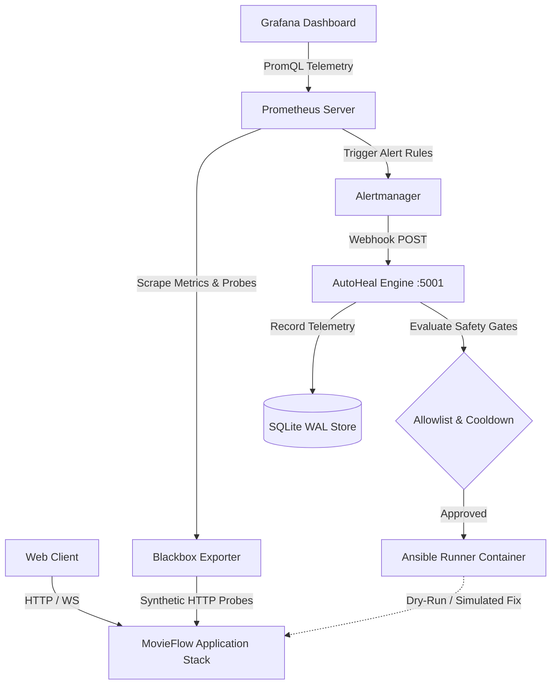

# MovieFlow AutoHeal: Presentation Slide Deck
**Course:** INT333 — Cloud Infrastructure & Automation Engineering  
**Project:** MovieFlow AutoHeal — Intelligent Infrastructure Monitoring, Automated Deployment & Self-Healing Platform  
**Target Format:** Academic Presentation (15 Slides)  

---

<!-- slide -->
# Slide 1: Title & Overview
## MovieFlow AutoHeal
### Intelligent Infrastructure Monitoring, Automated Deployment, and Self-Healing Platform for Distributed Web Applications

- **Course:** INT333 (Cloud Infrastructure & Automation Engineering)
- **Presenter:** [Student Name Placeholder] | [Registration Number Placeholder]
- **Department:** Department of Computer Science & Engineering
- **Focus:** Closed-Loop Reliability, SRE Automation, Defensive Safety Guardrails

---

<!-- slide -->
# Slide 2: Problem Statement & Motivation
## The Operational Challenge in Distributed Cloud Services

- **Delayed Anomaly Detection:** Passive monitoring causes outages to be discovered by end users rather than automated probes.
- **Manual Triage Overhead:** Human diagnostic triage averages 10–30 minutes to investigate logs and restart hung processes.
- **The Danger of Naive Restarts:** Unbounded automated scripts or blind Docker `restart: always` flags risk crash loops and catastrophic corruption if applied to stateful databases.
- **Project Motivation:** Build an intelligent, policy-bounded self-healing platform that eliminates operational toil while guaranteeing absolute database safety.

---

<!-- slide -->
# Slide 3: Project Objectives
## Engineering a Bounded Self-Healing Platform

1. **Deploy & Orchestrate:** Containerize the multi-tier MovieFlow application on Docker Compose.
2. **End-to-End Observability:** Deploy Prometheus, Alertmanager, Grafana, Blackbox Exporter, Node Exporter, and cAdvisor.
3. **Automate Failure Classification:** Build a Python/FastAPI decision daemon that maps Alertmanager webhooks to remediation policies.
4. **Declarative Recovery:** Author idempotent Ansible playbooks to execute verified container lifecycle operations.
5. **Concentric Safety Defenses:** Enforce service allowlists, hard database blocks, 300s anti-flap cooldowns, and 3-strike circuit breakers.
6. **Empirical Verification:** Validate decision latency and recovery safety across an isolated 43-test verification suite.

---

<!-- slide -->
# Slide 4: Existing MovieFlow Application
## Multi-Tier Distributed Social Streaming Architecture

- **Frontend (Next.js / React):**
  - Next.js 14.2.18, React 18.3.1, TypeScript, Tailwind CSS. Host Port `6060` (container port `3000`).
  - Synthetic availability probe at `GET /api/health`.
- **Backend (Django / Daphne ASGI):**
  - Django 5.1.15, Daphne 4.1.2 ASGI server, Django Channels. Host Port `8000`.
  - Dynamic core health check at `GET /api/core/health/` (asserts DB & channel broker status).
- **Relational Storage (PostgreSQL 15):**
  - Stateful user data and media metadata; persistent Docker volume; **Strictly non-remediable**.
- **Cache & Message Broker (Redis 7):**
  - In-memory WebSocket message bus and channel layer. Host Port `6379`.

---

<!-- slide -->
# Slide 5: Technology Stack & Component Roles
## Modern Cloud-Native & Site Reliability Engineering Tools

| Technology | Version | Architectural Role |
| :--- | :---: | :--- |
| **Docker & Compose** | 27.x / v2 | Multi-container lifecycle, internal bridge networking, volumes |
| **Prometheus** | v3.4.0 | Time-series metrics collection, alert rule evaluation every 15s |
| **Blackbox Exporter** | v0.25.0 | Synthetic HTTP prober checking endpoint response codes and latencies |
| **Node Exporter & cAdvisor** | v1.8.2 / v0.49.1 | Host hardware telemetry and container cgroup utilization |
| **Alertmanager** | v0.28.0 | Alert grouping, deduplication, and webhook dispatch |
| **FastAPI / Uvicorn** | Python 3.11 | High-performance AutoHeal decision daemon & incident store |
| **Ansible Core** | 2.16.x | Idempotent, declarative playbook execution via runner container |
| **Grafana** | 11.1.0 | Real-time observability dashboard (44 panels across 8 rows) |

---

<!-- slide -->
# Slide 6: Overall System Architecture
## Closed-Loop Telemetry & Autonomous Remediation

---

<!-- slide -->
# Slide 7: Monitoring Implementation
## Multi-Tier Metric Ingestion & Synthetic Probing

- **External Synthetic Probes:** Blackbox Exporter probes `/api/health` and `/api/core/health/` from outside the container processes, measuring real socket connection latencies.
- **Internal Host Telemetry:** Node Exporter tracks host CPU idle percentages, memory pressure, and disk I/O.
- **Container Cgroup Telemetry:** cAdvisor monitors container-specific memory limits, throttle cycles, and network throughput.
- **Prometheus Targets:** 8 active scrape targets configured with 15s intervals; **8/8 verified UP** in production.

---

<!-- slide -->
# Slide 8: Alerting Workflow & Rules
## Proactive Thresholds and Routing

- **Rule Definition:** Rules evaluate over 30s–2m windows to filter transient network jitter:
  - `BackendUnavailable`: Blackbox probe failure on Django core health check (Critical, 30s).
  - `FrontendUnavailable`: Blackbox probe failure on Next.js health check (Critical, 30s).
  - `MonitoringStackDown`: Prometheus or Alertmanager scrape targets unreachable (Critical, 1m).
  - `HighHostCPUUsage` / `LowHostMemory`: Host resource exhaustion (Warning, 2m).
- **Alertmanager Processing:** Alerts are grouped by signature (`alertname`, `service`, `severity`) and dispatched as JSON payloads to `http://autoheal:5001/webhook/alerts`.

---

<!-- slide -->
# Slide 9: AutoHeal Engine Architecture
## Intelligence, Classification, and Decision Logic

1. **Webhook Receiver:** Ingests Alertmanager JSON payloads with Pydantic model validation.
2. **Rule-Based Classifier:** Normalizes service names, categorizes failure types, and assigns confidence weights ($0.95$ for known failure signatures; $0.50$ for unknown).
3. **Decision Engine:** Evaluates policy mappings and requires confidence $\ge 0.90$ to proceed.
4. **Persistent SQLite Store:** Records every alert, decision, execution status, and duration in `/data/autoheal.db` using WAL mode.
5. **Deduplication Engine:** Suppresses redundant active incidents using fingerprint hashing.

---

<!-- slide -->
# Slide 10: Ansible Recovery Automation
## Idempotent, Auditable Playbooks via Runner Container

- **Modular Playbooks:**
  - `recover_backend.yml`: Restarts backend, waits for TCP socket 8000, and verifies `/api/core/health/`.
  - `recover_frontend.yml`: Restarts frontend and verifies `/api/health`.
  - `recover_redis.yml`: Restarts Redis and verifies port 6379 ping.
- **Containerized Isolation:** The AutoHeal daemon dispatches a dedicated `movieflow-ansible-runner:latest` container, preventing dependency collision.
- **Enforced Check-Mode:** In dry-run simulation mode, Ansible is invoked with `--check`, verifying syntax and task paths without modifying live container states.

---

<!-- slide -->
# Slide 11: Grafana Observability Dashboard
## 44 Panels Across 8 Logical Sections

- **Section A:** System Overview & High-Contrast `DRY-RUN / SIMULATED` Safety Banner.
- **Section B:** MovieFlow Service Health (Probes, Latencies in ms, HTTP Status Codes).
- **Section C:** Host & Container Infrastructure Metrics (CPU, Memory, Network I/O).
- **Section D:** Prometheus Scrape Target Health Grid (8/8 targets UP).
- **Section E:** Alert Monitoring, Active Incidents Table, and Severity Breakdown.
- **Section F:** AutoHeal Engine Metrics (Attempts, Simulated Runs, Verified Successes, Latency).
- **Section G & H:** Decision Flow Breakdown, Cooldown Suppressions, and Circuit Breaker States.
- *(Screenshot evidence verified at `screenshots/final_step_18.png`)*

---

<!-- slide -->
# Slide 12: Concentric Safety Guardrails
## Six Defensive Layers Against Operational Harm

1. **Strict Target Allowlist:** Only `backend`, `frontend`, and `redis` can be remediated.
2. **Forbidden Target Shield:** `postgres`, `database`, `prometheus`, `grafana` are permanently blocked (`SKIPPED_FORBIDDEN_SERVICE`).
3. **Anti-Flap Cooldown:** 300-second quiet period per service post-recovery; suppresses repeat triggers (`SKIPPED_COOLDOWN`).
4. **Circuit Breaker:** Trips to `OPEN` after 3 consecutive failures; suspends automation for 600s.
5. **Confidence Gating:** Requires confidence $\ge 0.90$; ambiguous alerts require manual review.
6. **Enforced Simulation:** `DRY_RUN=True` hardcoded in deployment; zero destructive actions permitted.

---

<!-- slide -->
# Slide 13: Testing & Evaluation Results
## Exhaustive Isolated Verification (43/43 Passed)

- **Isolated Test Suite:** Pytest executed inside the AutoHeal container with fully mocked subprocess calls and in-memory databases.
- **Test Categories Evaluated:**
  - Alert Classification & Unknown Alerts (8 tests: 100% PASS)
  - Forbidden Target Shielding (3 tests: 100% PASS)
  - Dry-Run Simulation Enforcement (3 tests: 100% PASS)
  - Cooldown & Circuit Breaker State Transitions (2 tests: 100% PASS)
  - Runner Timeouts & Missing Image Handling (2 tests: 100% PASS)
  - Approval Authentication & Parameter Tampering (3 tests: 100% PASS)
  - Webhook Ingestion & Deduplication (5 tests: 100% PASS)
- **Zero Disruptions:** All live containers maintained uninterrupted uptime during testing.

---

<!-- slide -->
# Slide 14: Performance Benchmarks & Security
## Sub-Millisecond Decision Latencies & Threat Analysis

- **Empirical Micro-Benchmarks (Synthetic Data):**
  - Alert Classification Latency: **`0.0025 ms`** average ($n=50$)
  - Decision Engine Latency: **`0.1213 ms`** average ($n=50$)
  - Safety Validation Latency: **`0.0005 ms`** average ($n=50$)
  - End-to-End HTTP Webhook Pipeline: **`19.21 ms`** average ($n=20$)
- **Documented Security Findings (Tracked for Production):**
  - *Docker Socket Exposure (High):* Transition to rootless proxy or out-of-band SSH bastion.
  - *Webhook Auth (Medium):* Implement Alertmanager HMAC-SHA256 request signatures.
  - *Distributed State (Low):* Back cooldown and circuit breaker states with clustered Redis.

---

<!-- slide -->
# Slide 15: Conclusion & Summary
## Key Achievements & Final Deliverables

- **Autonomous Resilience:** Proven closed-loop monitoring, classification, and simulated remediation for multi-tier applications.
- **Safety by Design:** Hard-coded database protection, anti-flap cooldowns, and circuit breakers eliminate runaway automation risks.
- **Academic Rigor:** 43 automated test assertions passed, 44 Grafana panels verified live, complete documentation, demo guide, and viva preparation.
- **Ready for Academic Review:** Platform baseline intact, safety invariants verified, and evaluation complete.

### Thank You!
**Questions & Discussion**
